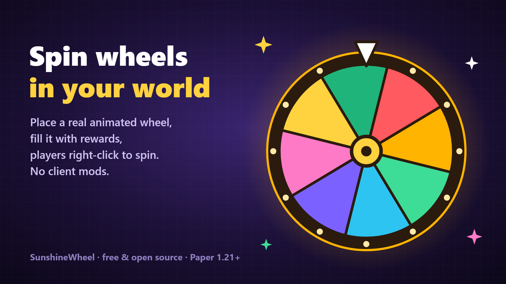

# SunshineWheel: Spin Wheel Plugin for Minecraft (Paper 1.21+)

A free, open-source **spin wheel / lucky wheel / prize wheel** plugin for Minecraft Paper
servers. You place a real, animated wheel in your world, fill it with rewards from a browser
editor, and players right-click it to spin. Use it for daily rewards, vote rewards, crate-style
prizes and events. Everything is drawn with display entities and a tiny font pack that the
plugin builds and hosts for you, so players don't need any mods.

[Setup guide](https://rehber.sunshine-mc.net/wheel-setup.html) ·
[Download](https://github.com/lordon1a/SunshineWheel/releases/latest) ·
[Discord](https://discord.gg/4fmZUfqnHw) ·
[Changelog](https://github.com/lordon1a/SunshineWheel/blob/master/CHANGELOG.md)



## Quick start

1. Put the jar in `plugins/` and restart. You need Paper 1.21 or newer and Java 21.
2. The console prints a resource pack URL and sha1. Copy them into `server.properties`
   as `resource-pack=` and `resource-pack-sha1=`, then restart again.
3. Three example wheels are ready: `daily`, `premium` and `vote`. Run `/wheel move daily`
   and right-click the block where it should go. A wheel on the floor stands up;
   a wheel on a wall hangs from it.
4. Run `/wheel web`, open the link and edit the rewards. Saving updates the wheel in game
   right away.

To start from scratch, run `/wheel create <id>` and right-click a block.

## What players see

- Right-click spins the wheel. The pointer ticks across the slices and slows down
  with the easing style you picked.
- Left-click opens a chest menu with every reward, its chance and what it pays out.
  Rewards the player can't win yet show as locked.
- Sneak + right-click prints the same list in chat.
- Winning plays a sound and a particle or firework effect. You can also announce wins
  to the whole server.

Slice sizes follow the reward weights by default. A 5% reward gets a thin slice,
so what players see matches the real odds. Turn this off with
`appearance.weighted-slices: false` if you want equal slices.

## What you can set per wheel

**Rewards:** name (MiniMessage, `<chance>` shows the live percentage), weight, slice
colour, icon item, console commands (`%player%`, `%reward%`, `%wheel%`), required
permission, win message and sound. A reward can be turned off without deleting it.

**Reward items:** a vanilla item with amount, lore, glow and custom model data, or an
exact copy of an item you hold in game (`/wheel setitem <wheel> <n>`). Copies work for
heads, enchanted gear and custom items. You can also give items by plugin ID from
Oraxen, ItemsAdder, MMOItems, Nexo or ExecutableItems, for example
`/wheel setitem daily 2 oraxen:ruby`.

**Spin cost:** any mix of a ticket item, Vault money, XP levels and extra console
commands. All costs are checked before anything is taken, and if a spin is interrupted,
the player gets everything back. Free spins and cooldowns are saved per player and
survive restarts.

**Looks:** size, frame, hub and pointer colours, hologram title, spin duration,
revolutions, easing style, ambient particles while spinning, and the win effect.

## Commands

All commands use `/wheel` (alias `/cark`) and need `sunshinewheel.admin`.

| Command | |
|---|---|
| `web` | One-time login link for the web editor |
| `create <id>` · `move <id>` · `cancel` | Place a wheel by right-clicking a block |
| `remove <id>` · `list` · `reload` | Manage wheels, reload from disk |
| `spin <id>` · `preview <id>` · `menu <id>` | Test a spin, list rewards, open the chance menu |
| `setitem <id> <reward> [provider:id]` | Set a reward item from your hand or by plugin ID |
| `set <id> <key> <value>` | Quick settings without opening the editor |
| `give` · `take <player> <wheel> <n>` | Free spins |
| `ticket <give\|take> <player> <wheel> <n>` | Ticket items |
| `stats [player]` · `resetcooldown <player> <wheel>` | Player data |

## Integrations

- **Vault:** money as a spin cost
- **PlaceholderAPI:** `%sunshinewheel_<id>_spins%`, `_wins%`, `_free%`, `_cooldown%`
- **Developer events:** `WheelSpinStartEvent` and `WheelSpinWinEvent`. Both are cancellable.

## Web editor and resource pack

The plugin runs one small HTTP server (`web.port`, default `8770`). It serves the editor,
its JSON API and `pack.zip`.

- Open the port in your firewall or host panel. Then visit `http://YOUR-IP:8770/` and
  paste the key from `/wheel web`.
- For HTTPS, keep `web.bind: 127.0.0.1` and put nginx in front of it. A ready config is
  in [`examples/nginx-wheel.conf`](https://github.com/lordon1a/SunshineWheel/blob/master/examples/nginx-wheel.conf).
- Already using a server resource pack? Copy `assets/sunshinewheel` from the generated
  `pack.zip` into your own pack, because a server can only send one pack.

Login links work once and expire after 10 minutes. Sessions last 12 hours and can be
ended with the logout button.

## Language

In-game messages are in `messages.yml` (English). Set `language: tr` in `config.yml`
to use Turkish. The web editor is in English.

## Network and privacy

- The update checker downloads one small JSON file from `rehber.sunshine-mc.net` every
  6 hours to tell admins about new versions. It sends no player or server data. Turn it off
  with `update-checker.enabled: false`.
- The web editor and `pack.zip` are served by the plugin on your own server (`web.port`).
  Nothing is uploaded anywhere else.
- No analytics or metrics are collected.

## Building from source

```bash
./gradlew build          # Windows: .\gradlew.bat build
```

The jar ends up in `build/libs/`. `./gradlew releaseZip` also packs the editor files,
the resource pack and the nginx examples.

## Contributing

Issues and pull requests are welcome. Before you open a PR, run `./gradlew build`
and test the change on a Paper server.

## License

[MIT](https://github.com/lordon1a/SunshineWheel/blob/master/LICENSE). You can use it, change it and ship it on your server for free.
